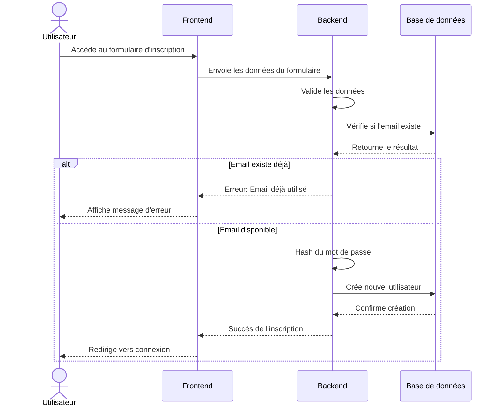
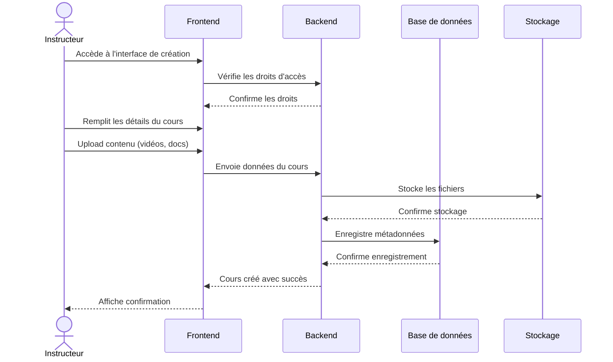
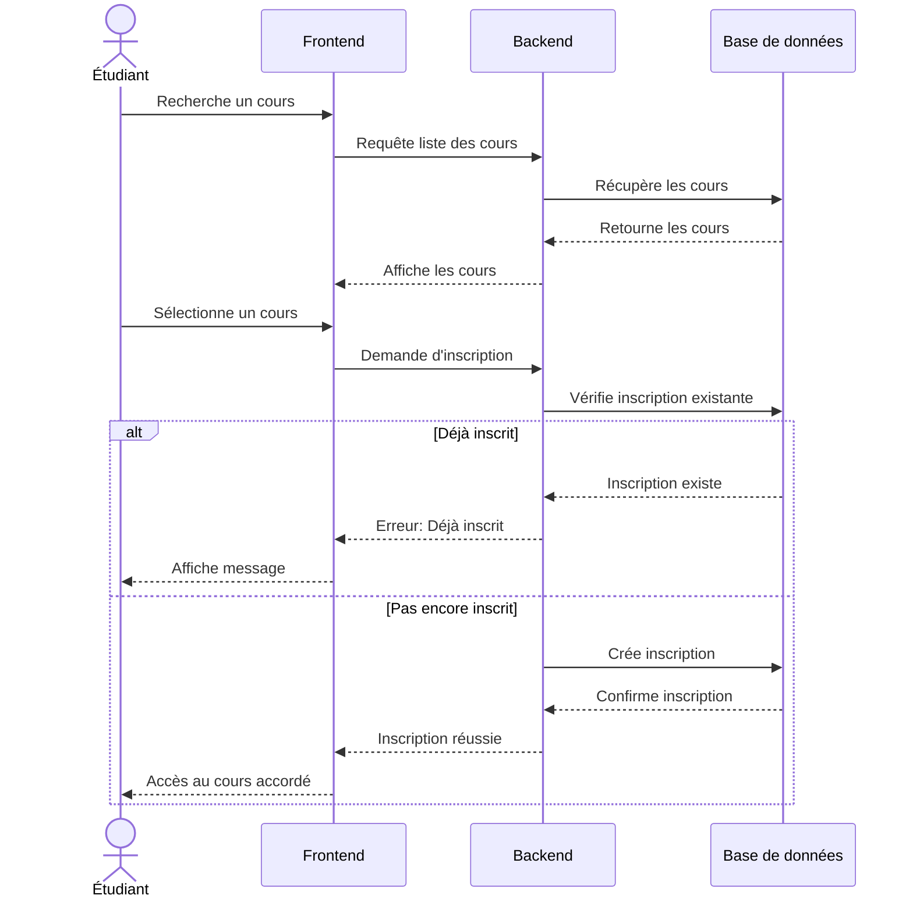
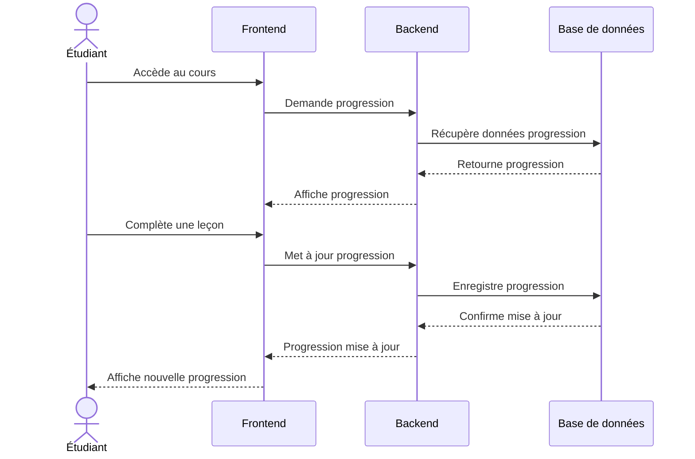
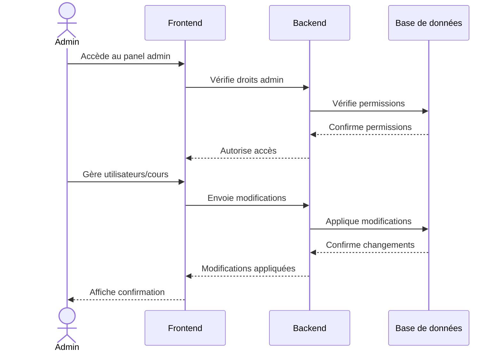

# Diagrammes de Séquence - Plateforme E-Learning

## 1. Inscription et Authentification

## 2. Création et Publication d'un Cours

## 3. Inscription à un Cours

## 4. Suivi de Progression

## 5. Administration

