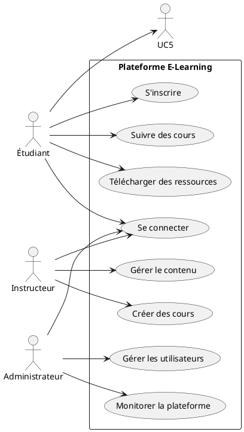
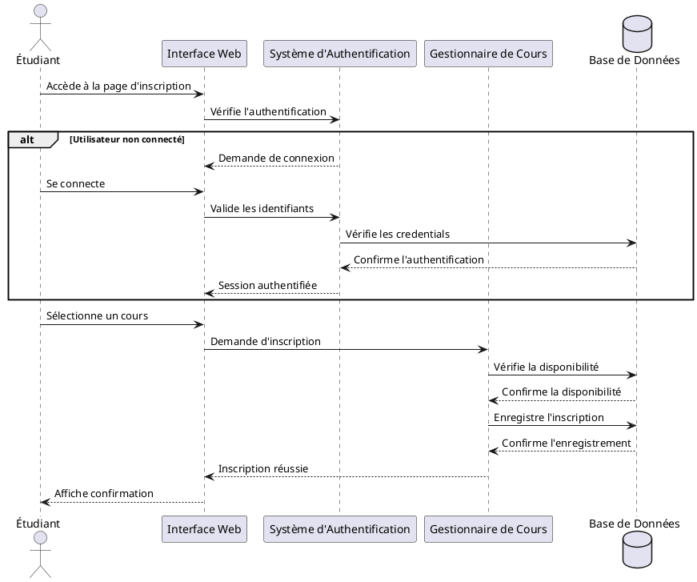
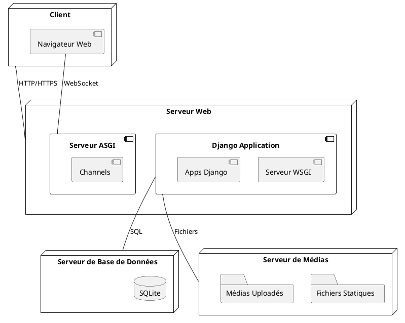
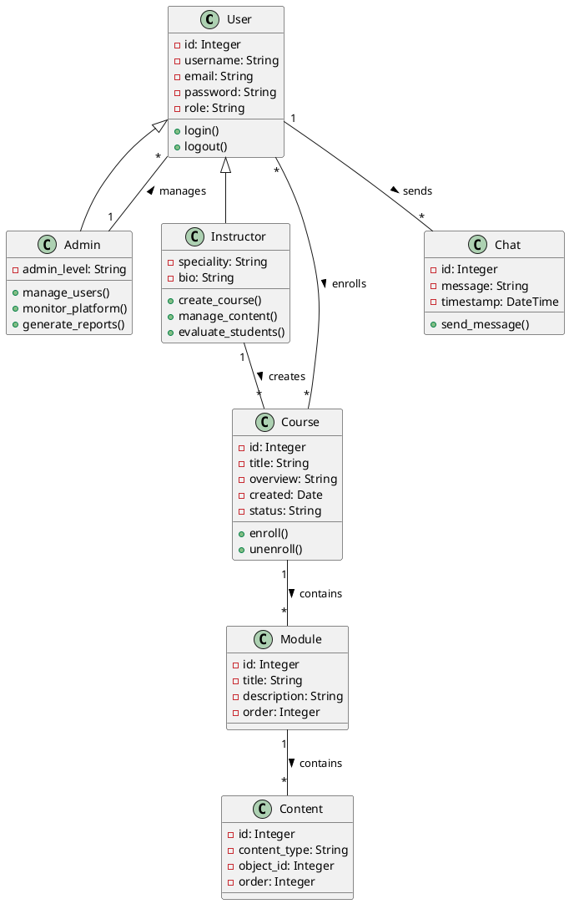
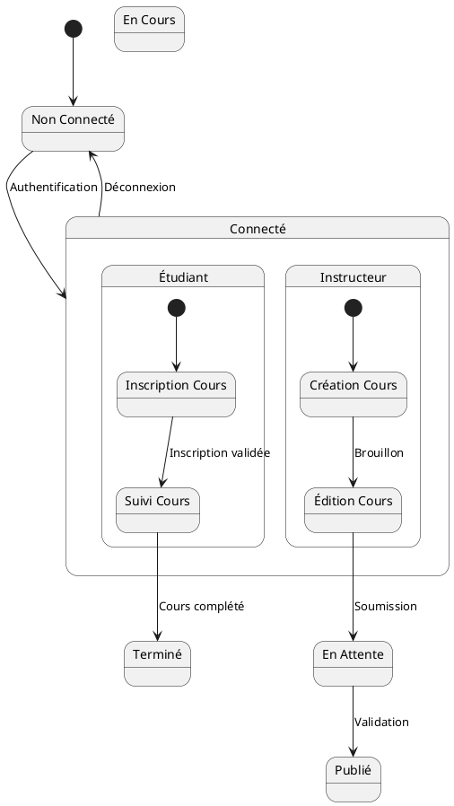
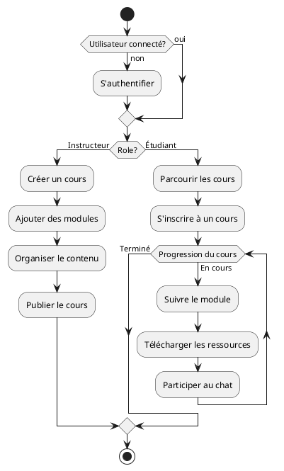

# Diagrammes UML - Plateforme E-Learning

## 1. Diagramme de Cas d'Utilisation



## 4. Diagramme de Séquence - Processus d'Inscription aux Cours



## 5. Diagramme de Déploiement



## 2. Diagramme de Classes



## 4. Diagramme de Séquence - Processus d'Inscription aux Cours


## 5. Diagramme de Déploiement

```plantuml
@startuml
node "Client" as client {
    component "Navigateur Web" as browser
}

node "Serveur Web" as webserver {
    component "Django Application" as django {
        component "Serveur WSGI" as wsgi
        component "Apps Django" as apps
    }
    component "Serveur ASGI" as asgi {0
        component "Channels" as channels
    }
}

node "Serveur de Base de Données" as dbserver {
    database "MySQL" as db
}

node "Serveur de Médias" as mediaserver {
    folder "Fichiers Statiques" as static
    folder "Médias Uploadés" as media
}

client -- webserver : HTTP/HTTPS
browser -- asgi : WebSocket
django -- dbserver : SQL
django -- mediaserver : Fichiers
@enduml
```

## 6. Diagramme d'État de Transition



## 3. Diagramme d'Activité

